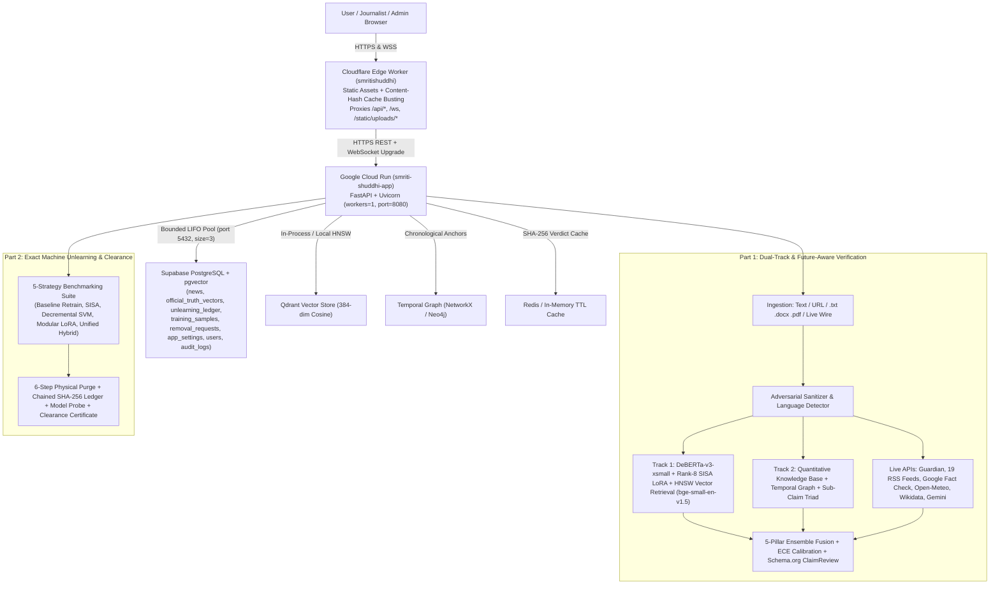

# Smriti Shuddhi (स्मृति शुद्धि) — Complete Technical, Algorithmic & Deployment Documentation

**Smriti Shuddhi** (*"Purification of Memory"*) is a production-deployed, multi-aspect fake news verification and exact machine unlearning platform. It combines real-time dual-track verification (including zero-day breaking & future claims) with legally/empirically verifiable **Right-to-be-Forgotten machine unlearning** across partitioned neural adapters, closed-form linear algebraic learners, modular LoRA masks, dense vector databases, temporal graphs, relational persistence, and semantic caches.

- **Live Web Application (Cloudflare Edge + Assets)**: `https://smritishuddhi.smritishuddhi.workers.dev`
- **Live FastAPI Backend (Google Cloud Run)**: `https://smriti-shuddhi-app-889339834867.asia-south1.run.app`
- **GitHub Repository**: `https://github.com/HarshithGadipelli/SmritiShuddhi.git`

---

## 1. End-to-End System Architecture



### Hosting & Domain Architecture
- **Why does Google Cloud Run use a Docker container?**  
  Google Cloud Run natively executes stateless OCI/Docker containers built from [Dockerfile](file:///c:/Users/Harshith%20Gadipelli/Documents/Projectlu/SmritiShuddhi/Dockerfile). Even when deploying from GitHub ("Source Deploy" or Cloud Build), Google Cloud Build clones your GitHub repository, builds the container image remotely using [cloudbuild.yaml](file:///c:/Users/Harshith%20Gadipelli/Documents/Projectlu/SmritiShuddhi/cloudbuild.yaml), pushes it to Artifact Registry (`asia-south1-docker.pkg.dev`), and rolls out the Cloud Run revision automatically.
- **Why is the Cloudflare URL `https://smritishuddhi.smritishuddhi.workers.dev`?**  
  Free `*.workers.dev` deployments on Cloudflare require the `<worker-name>.<account-subdomain>.workers.dev` structure (`smritishuddhi` under the `smritishuddhi` account subdomain). A standalone bare hostname without a subdomain (such as `https://smritishuddhi`) cannot resolve over public internet DNS unless you register a top-level custom domain (e.g., `smritishuddhi.com`, `smritishuddhi.in`, or `smritishuddhi.org`), add its DNS zone to Cloudflare, and bind it as a Worker Custom Domain Route.
- **How UI parity between Localhost and Cloudflare Edge is enforced:**  
  [sync-assets.mjs](file:///c:/Users/Harshith%20Gadipelli/Documents/Projectlu/SmritiShuddhi/cloudflare/scripts/sync-assets.mjs) copies every frontend asset from `templates/enterprise_dashboard.html` and `static/` into `cloudflare/public/`, injects SHA-256 content-hash query parameters (`?v=<hash>`) onto `/static/dashboard.css` and `/static/dashboard.js`, and sets `Cache-Control: no-cache, no-store, must-revalidate` on HTML responses in [src/index.ts](file:///c:/Users/Harshith%20Gadipelli/Documents/Projectlu/SmritiShuddhi/cloudflare/src/index.ts) so browsers immediately receive the exact deployed frontend without stale cache drift. Runtime document uploads saved on Cloud Run (`/static/uploads/*`) are proxied transparently by the Worker (`runWorkerFirst`).

---

## 2. Part 1 Complete Workflow: Real-Time & Future-Aware Fake News Detection

Every news submission (`POST /api/v1/news/submit`) or synced live wire story flows through the following technical and practical pipeline in [app/main.py](file:///c:/Users/Harshith%20Gadipelli/Documents/Projectlu/SmritiShuddhi/app/main.py), [app/models/fusion.py](file:///c:/Users/Harshith%20Gadipelli/Documents/Projectlu/SmritiShuddhi/app/models/fusion.py), [app/retrieval/knowledge_base.py](file:///c:/Users/Harshith%20Gadipelli/Documents/Projectlu/SmritiShuddhi/app/retrieval/knowledge_base.py), [app/retrieval/external_verifiers.py](file:///c:/Users/Harshith%20Gadipelli/Documents/Projectlu/SmritiShuddhi/app/retrieval/external_verifiers.py), and [app/retrieval/graph_store.py](file:///c:/Users/Harshith%20Gadipelli/Documents/Projectlu/SmritiShuddhi/app/retrieval/graph_store.py):

### Step 1: Multi-Modal Content Ingestion
1. **Direct Broadsheet Entry**: Title, body, source, author, category, and optional image URL.
2. **Document Upload Extraction (`POST /api/v1/news/extract-document`)**: Parses `.txt`, `.md`, `.json`, `.csv`, `.docx` (OOXML `word/document.xml`), and `.pdf` via [document_parser.py](file:///c:/Users/Harshith%20Gadipelli/Documents/Projectlu/SmritiShuddhi/app/utils/document_parser.py), splits headline and body automatically, and stores the attachment via [storage.py](file:///c:/Users/Harshith%20Gadipelli/Documents/Projectlu/SmritiShuddhi/app/utils/storage.py) (Supabase Storage if configured, otherwise Cloud Run `/static/uploads/*`).
3. **Live URL Scraping (`POST /api/v1/news/extract-url`)**: Fetches external article HTML/JSON-LD/OpenGraph tags via `extract_article_from_url()` in [news_feed.py](file:///c:/Users/Harshith%20Gadipelli/Documents/Projectlu/SmritiShuddhi/app/retrieval/news_feed.py).
4. **Live Wire Sync (`POST /api/v1/news/sync-live`) & Topic Search (`GET /api/v1/news/search-topic`)**: Fetches across **The Guardian Open Platform** and **19 Indian & global RSS feeds** (The Hindu, Times of India, Indian Express, NDTV, PIB, ISRO/Space, BBC, Reuters/AP, TechCrunch, Google News India, plus Hindi and Telugu Google News feeds), as well as optional `TheNewsAPI`, `NewsAPI`, and `GNews`.

### Step 2: Adversarial Defense & Linguistic Identification
1. `AdversarialDefenseAnalyzer` strips zero-width Unicode obfuscation characters (`\u200b`..`\ufeff`), normalizes homoglyphs, detects leetspeak/stylometric evasion (e.g., `500 n0tes`, `R.B.I`), and neutralizes prompt-injection markers (`IGNORE PREVIOUS INSTRUCTIONS`, `SYSTEM OVERRIDE`).
2. Script detection identifies **English**, **Hindi (`\u0900-\u097F`)**, or **Telugu (`\u0C00-\u0C7F`)** and passes text through `regional_encoder` (`BAAI/bge-small-en-v1.5`, 384-dimensional dense embeddings).

### Step 3: SHA-256 Cache Lookup
- `cache_controller.generate_signature(title, text)` computes a deterministic SHA-256 key (`bypass_cache=False` checks Redis or the in-memory cache before triggering full multi-track inference).

### Step 4: Dual-Track & External Grounding Analysis
1. **Track 1 — Stylometry & Sharded LoRA Inference (`lora_sisa_engine`)**:
   - Uses frozen base representation (`deberta-v3-xsmall` or neural embedding fallback when offline) combined with $K=5$ Rank-8 LoRA adapters ($\Delta W = \frac{\alpha}{r} B A$, with rank $r=8$, $\alpha=16$) to compute stylometric manipulation risk $S_{\text{content}}$ (`s_style`) and cross-shard dispersion.
2. **Track 2 — Dense Evidence, Graph & Quantitative Checks**:
   - **Qdrant HNSW + Supabase `pgvector` (`<=>` cosine operator)**: Queries `official_truth_vectors` against curated official debunks and institutional releases (PIB, RBI, ISRO, IMD, ECI) to compute $S_{\text{fact}}$.
   - **`InternalEvidenceEngine`**: Offline-resilient local registry matching critical sovereign debunks (e.g., 500-rupee demonetization rumors, free laptop/cash phishing scams, verified ISRO releases).
   - **`TemporalGraphEngine` (`HISTORICAL_ANCHORS` + Future News Checker)**:
     - Verifies chronological consistency ($S_{\text{context}}$) across historical entities/dates in NetworkX (or Neo4j if configured).
     - **Future & Developing Assertions**: Flags past completed events falsely framed as upcoming crises (*Temporal Discontinuity*) and detects unverified future policy bans/handouts (`will ban`, `starting tomorrow`, `from midnight`, `predicted for 2026–2029`) lacking official gazette/circular attribution (*Unverified Future Policy Assertion*).
   - **`QuantitativeAnomalyEngine`**: Cross-checks numeric claims against real-world financial and physical bounds (`BSE Sensex`, `NSE Nifty`, `24K Gold INR`, `Brent Crude Oil`, `USD/INR`, `RBI Repo Rate`, `currency_banknotes`, and state temperature ceilings).
3. **External Real-Time Grounding (`external_verifiers.py`)**:
   - **`LiveFactCheckClient`**: Two-layer verifier calling **Google Fact Check Tools API** first and automatically falling back to **Google News Fact-Check / PIB / Alt News RSS**.
   - **`LiveOpenMeteoVerifier`**: Fetches real-time city telemetry (`New Delhi`, `Hyderabad`, `Mumbai`, etc.) from Open-Meteo and flags physically impossible weather claims or large temperature deviations (`>= 18°C`).
   - **`StructuredNERAndSPOEngine` + Wikidata**: Extracts entities (`ORG`, `GPE`, `PERSON`, `DATE_TIME`, `QUANTITY`), Subject–Predicate–Object triples, quote-attribution anomalies, and validates entity IDs against live Wikidata `wbsearchentities`.
   - **`HeadlineStanceAnalyzer` & `WebsitePropagationTracker`**: Detects clickbait headline-body divergence and tracks real-time platform submission/share/flag bursts ($\mathrm{d}M/\mathrm{d}t$).
4. **Deep Epistemic, Forensic & Calibration Engines (`knowledge_base.py`)**:
   - `EntitySpecificityAnalyzer` (vagueness penalties on anonymous rumors)
   - `AdvancedJustificationMetricsEngine` (HSDI, Shannon Entropy bits, Type-Token Ratio, EPPI, Claim Criticality Index)
   - `BreakingNewsCorroborationEngine` (checks real-time cross-source publisher corroboration across wire dispatches)
   - `SubClaimDecompositionEngine` (clause-level decomposition identifying *Partially True / Half-Truth* claims vs *Completely Fabricated*)
   - `ZeroKnowledgeDisambiguator` (epistemic triad separation: factual violation vs benign abstract assertion vs developing citizen report)
   - `MultimodalForensicsEngine` (image-headline congruence, domain/author metadata checks, and **Schema.org `ClaimReview` JSON-LD** certificate generation via `/api/v1/news/{news_id}/claim-review`)
   - `EpistemicCalibrationEngine` (Brier score + Expected Calibration Error $ECE = 0.04 + 0.2\sigma_{\text{shards}}$)
   - **`GeminiFactSynthesisClient`** (`gemini-3-flash-preview` default with fallback chain): Synthesizes a 2-sentence neutral justification on borderline / half-truth claims (`0.30 <= p_fake < 0.70`).

### Step 5: 5-Pillar Dynamic Ensemble Fusion & 3-Tier Editorial Routing
In [EnsembleFusionLayer.fuse](file:///c:/Users/Harshith%20Gadipelli/Documents/Projectlu/SmritiShuddhi/app/models/fusion.py):

$$P_{\text{fake,raw}} = w_{\text{content}} S_{\text{content}} + w_{\text{context}} S_{\text{context}} + w_{\text{knowledge}} S_{\text{knowledge}} + w_{\text{propagation}} S_{\text{propagation}} + w_{\text{source}} S_{\text{source}} + \text{penalties}$$

- **When Evidence Matched** (`EVIDENCE_MATCHED` or internal archive match):  
  $w_{\text{knowledge}}=0.35,\; w_{\text{content}}=0.20,\; w_{\text{source}}=0.20,\; w_{\text{context}}=0.15,\; w_{\text{propagation}}=0.10$
- **Zero-Shot Predictive Mode**:  
  $w_{\text{content}}=0.30,\; w_{\text{knowledge}}=0.25,\; w_{\text{source}}=0.20,\; w_{\text{propagation}}=0.15,\; w_{\text{context}}=0.10$
- **Safety Escalations**: Quantitative anomalies, confirmed debunks (`>= 0.85` fact-check risk), Open-Meteo physical impossibilities (`>= 0.85`), timeline contradictions, and unsubstantiated critical breaking rumors escalate probability into high-risk quarantine. **Breaking/developing news overrides are strictly guarded by `risk_band != "HIGH_RISK_FAKE"`** so `"BREAKING"` prefixes cannot bypass quarantine.

| Probability Band | Classification (`tag`) | Database `status` | Platform Action & Notification |
| :--- | :--- | :--- | :--- |
| $P_{\text{fake}} < 0.30$ | `REAL` (`LOW_RISK_FACTUAL`) | `PUBLISHED` | Auto-published to live broadsheet wire + `NEW_ARTICLE_PUBLISHED` WebSocket event |
| $0.30 \le P_{\text{fake}} < 0.70$ | `LIKELY_FAKE` / `HALF_TRUTH` (`MODERATE_RISK`) | `PENDING_ADMIN_REVIEW` | Held in Editorial Review queue + Gemini synthesis + `ALERT_PENDING_REVIEW` WebSocket |
| $P_{\text{fake}} \ge 0.70$ | `FAKE` (`HIGH_RISK_FAKE`) | `BLOCKED_HIGH_RISK_FAKE` | Quarantined from public feed, loaded into Admin Unlearning Workbench + `ALERT_HIGH_RISK_FAKE` |

---

## 3. Part 2 Complete Workflow: Exact Machine Unlearning & Clearance Verification

Smriti Shuddhi implements **5 empirical unlearning strategies** evaluated side-by-side in real time in [app/unlearning/algorithms.py](file:///c:/Users/Harshith%20Gadipelli/Documents/Projectlu/SmritiShuddhi/app/unlearning/algorithms.py) and [app/unlearning/engine.py](file:///c:/Users/Harshith%20Gadipelli/Documents/Projectlu/SmritiShuddhi/app/unlearning/engine.py):

### The 5 Implemented Unlearning Strategies
1. **`baseline_retrain` — Full Retraining from Scratch (Reference Baseline)**  
   Rebuilds TF-IDF vocabulary ($d=320$) and re-optimizes `LogisticRegression` from scratch over $D \setminus D_f$. Guarantees exact unlearning ($L_2 = 0.0$, $\text{MIA AUC} = 0.500$) at $100\%$ parameter recomputation cost ($1.0\times$ reference speed).
2. **`algorithm_1_sisa` — SISA Sharded Data Partitioning ($K=5$)**  
   Deterministically hashes `sample_id` via SHA-256 modulo $K=5$ into isolated shards $D_0 \dots D_4$. On deletion of target $x^*$, only the affected shard(s) drop $x^*$ from CSV/DataFrame and micro-retrain, keeping untouched shards intact ($20\%$ parameter update per single shard).
3. **`algorithm_2_svm` — Closed-Form Decremental SVM / Ridge Learner ($O(d^2)$ Algebraic Downdate)**  
   Maintains the regularized Gram inverse Hessian $H^{-1} = (X^\top X + \lambda I)^{-1}$ in $d=256$ TF-IDF space and removes forgot point(s) $(x_i, y_i)$ deterministically using the **Sherman-Morrison-Woodbury formula**:
   $$H^{-1}_{\text{new}} = H^{-1} + \frac{(H^{-1} x_i)(H^{-1} x_i)^\top}{1 - x_i^\top H^{-1} x_i}, \qquad w_{\text{new}} = w - \frac{(y_i - w^\top x_i)}{1 - x_i^\top H^{-1} x_i} H^{-1} x_i$$
   Compares $w_{\text{new}}$ directly against closed-form gold retraining $w_{\text{gold}}$ to measure exact **Weight $L_2$ Parity** $\|w_{\text{new}} - w_{\text{gold}}\|_2$.
4. **`algorithm_3_lora` — Modular Rank-8 LoRA Sub-Slice Deactivation ($r=8, \alpha=16$)**  
   Trains domain-sharded Rank-8 LoRA delta weights $\Delta W = \frac{\alpha}{r} B A$ across domains (`economy`, `science`, `weather`, `governance`, `tech`, `general`) and $4$ slices each while keeping base $W_0$ frozen. Deactivating an unlearned target zeros out only that slice's $B$ matrix and bias, persisting disabled slice keys to both `sisa_adapters/modular_lora_mask.json` and Supabase `app_settings` (`modular_lora_disabled_slices`).
5. **`algorithm_4_hybrid` — Smriti Shuddhi Unified Hybrid Engine (Default Production Engine)**  
   Orchestrates the full stack together: SISA partition & LoRA adapter micro-retraining + Decremental $H^{-1}$ algebraic downdate + Modular LoRA sub-slice masking + multi-store database/vector/graph/cache purge + chained SHA-256 ledger proof.

### Evaluation Metrics Tracked on Every Run
Every call to `/api/v1/unlearning/benchmark/all`, `/api/v1/admin/unlearn`, or `/api/v1/admin/unlearn-batch` computes real holdout evaluation metrics across $D_{\text{test}}$:
- **Execution Time (ms) & Speedup vs Baseline Retrain** (`T_baseline / T_algo`)
- **Retain Accuracy Before / After**, **Precision (B/A)**, **Recall (B/A)**, **F1 Score (B/A)**
- **Forget Residual Influence (%)** (normalized post-purge confidence delta on forgot target)
- **Weight $L_2$ Parity** ($\|\theta_u - \theta_r\|_2$ against exact retrained parameters)
- **Membership Inference Attack (MIA) ROC-AUC**: Evaluates an adversary's confidence-gap ROC distinguishability between $D_f$ and held-out unseen test predictions (`0.500` = indistinguishable from never-seen data).
- **Parameters Modified (%)**: Fraction of model parameters altered.

### 6-Step Database & Model Purge + Clearance Notification Workflow
Triggerable from **Quarantined Queue ("Unlearn Story")**, **Editorial Workbench ("Execute Active Strategy" / Batch Unlearn Top 3)**, **Citizen Removal Approval**, or **Admin Copilot (`unlearn_top`)**:

1. **Step 1 — Metadata Shard Routing**: Hashes target `sample_id` to isolate target SISA shard(s) $D_k$.
2. **Step 2 — Database & Partition Purge**:
   - Removes sample row from SISA shard CSV and master `train.csv` (`purged_sample_ids` also persisted to Supabase `app_settings` for stateless restarts).
   - Marks `news` row in Supabase PostgreSQL as `status = 'REVOKED_AND_UNLEARNED'`, `tag = 'UNLEARNED'`.
   - Permanently deletes matching row(s) from Supabase `training_samples` via `mark_training_samples_unlearned()`.
3. **Step 3 — Weight & Slice Eviction**: Deletes shard `.joblib`/`.pt` weights, downdates SVM $H^{-1}$, and zeroes/persists the target Modular LoRA sub-slice mask.
4. **Step 4 — Vector, Graph & Cache Purge**:
   - Deletes matching vectors from Qdrant HNSW AND Supabase PostgreSQL `official_truth_vectors` (`pgvector`) via `delete_truth_vector()`.
   - Removes matching non-anchor event nodes/edges from `graph_engine` (`purge_article()`).
   - Evicts SHA-256 signature + `sample_id` from Redis/memory cache (`cache_controller.evict_signature()`).
5. **Step 5 — Isolated Micro-Retraining & Chained SHA-256 Proof**: Retrains only the affected SISA shard and computes chained cryptographic ledger hash:
   $$\text{proof}_n = \text{SHA256}(\text{proof}_{n-1} \parallel \text{sample\_id} \parallel \text{strategy} \parallel \text{residual} \parallel t)$$
   written permanently to `unlearning_ledger` and `audit_logs`.
6. **Step 6 — Post-Unlearning Verification & Live Clearance Notification**:
   - Returns a structured `clearance_certificate` attesting every cleared layer (`supabase_news_revoked`, `training_samples_purged`, `sisa_shard_weights_evicted`, `svm_hessian_downdated`, `modular_lora_slice_masked`, `vector_qdrant_pgvector_purged`, `temporal_graph_nodes_removed`, `semantic_cache_evicted`).
   - Broadcasts `NEWS_REVOKED_AND_UNLEARNED` over `/ws`, displays the **Verified Clearance Notification Banner** in the UI, updates the **Unlearning Audit Ledger**, and automatically invokes **Interactive Model Residual Memory Probe** (`POST /api/v1/admin/model-probe`, checking SVM margin $w \cdot x$, LoRA shard dispersion, SISA CSV substrings, and vector similarity) to verify **`ZERO_RESIDUAL_MEMORIZATION`**.

---

## 4. Complete API Endpoint Reference

| Endpoint | Method | Purpose |
| :--- | :--- | :--- |
| `/` | `GET` | Serves broadsheet UI (`enterprise_dashboard.html`) |
| `/api/v1/health` | `GET` | System readiness, ML state, active database backend |
| `/api/v1/news` | `GET` | Published wire feed dispatches |
| `/api/v1/news/{news_id}` | `GET` | Single article detail + 5-pillar XAI breakdown |
| `/api/v1/news/{news_id}/claim-review` | `GET` | Schema.org `ClaimReview` JSON-LD payload |
| `/api/v1/news/submit` | `POST` | Submit article for real-time dual-track verification |
| `/api/v1/news/extract-document` | `POST` | Extract text/metadata from base64 `.txt`, `.docx`, `.pdf`, `.md`, `.csv`, `.json` |
| `/api/v1/news/extract-url` | `POST` | Scrape headline/source/body from live HTTP/HTTPS article URL |
| `/api/v1/news/sync-live` | `POST` | Sync & verify fresh dispatches from Guardian + 19 RSS feeds |
| `/api/v1/news/search-topic` | `GET` | Dynamic zero-key Google News topic search (`?q=...&limit=...`) |
| `/api/v1/news/status` | `GET` | Published count & live external API configuration flags |
| `/api/v1/news/configure-api` | `POST` | Dynamically update runtime external news/AI API keys |
| `/api/v1/news/{news_id}/engage` | `POST` | Record `view` / `share` / `bookmark` / `flag` propagation velocity |
| `/api/v1/news/{news_id}` / `/api/v1/admin/news/{news_id}/edit` | `PUT` / `POST` | Edit story fields & re-run Dual-Track verification |
| `/api/v1/news/{news_id}/request-removal` | `POST` | Submit citizen Right-to-be-Forgotten removal request |
| `/api/v1/user/submissions` | `GET` | List user-submitted articles and status badges |
| `/api/v1/weather/live` | `GET` | Live Open-Meteo telemetry for Indian cities |
| `/api/v1/evidence/search` | `GET` | Semantic search across Qdrant + Supabase `pgvector` |
| `/api/v1/graph/data` | `GET` | Temporal Knowledge Graph nodes and edges |
| `/api/v1/auth/register`, `/api/v1/auth/login`, `/api/v1/auth/me` | `POST` / `GET` | HMAC-SHA256 stateless token authentication (Journalist / Admin) |
| `/api/v1/admin/queue` | `GET` | Quarantined fake, pending editorial, and recent verified lists |
| `/api/v1/admin/approve/{news_id}` | `POST` | Editorial approve & publish pending story |
| `/api/v1/admin/reject/{news_id}` / `/api/v1/news/{news_id}` | `POST` / `DELETE` | Reject/delete dispatch from store |
| `/api/v1/admin/removal-requests` | `GET` | List citizen removal requests |
| `/api/v1/admin/removal-requests/{request_id}/approve` | `POST` | Approve removal request & execute exact unlearning |
| `/api/v1/admin/removal-requests/{request_id}/reject` | `POST` | Reject citizen removal request |
| `/api/v1/admin/unlearning-strategy` | `GET` / `POST` | Read or persist active production unlearning algorithm |
| `/api/v1/unlearning/benchmark/all` | `GET` | Benchmark all 5 unlearning algorithms simultaneously |
| `/api/v1/admin/unlearn` | `POST` | Execute exact machine unlearning & issue `clearance_certificate` |
| `/api/v1/admin/unlearn-batch` | `POST` | Multi-article batch machine unlearning + clearance certificate |
| `/api/v1/admin/model-probe` | `POST` | Direct weight/shard/vector probe for residual memorization |
| `/api/v1/admin/unlearning-ledger` (`/api/v1/admin/ledger`) | `GET` | Chained SHA-256 cryptographic unlearning audit ledger |
| `/api/v1/admin/copilot` | `POST` | Admin AI Copilot (`recommend_model`, `analyze_mia`, `queue_summary`, `inspect_db`, `unlearn_top`) |
| `/api/v1/admin/db-explorer` | `GET` | Real-time Supabase table counts, SISA shard telemetry & cache stats |
| `/api/v1/stats` | `GET` | Encoder, LoRA backbone, vector corpus & graph backend summary |
| `/ws` | `WebSocket` | Real-time event broadcast & keepalive (`ping` -> `pong`) |

---

## 5. Repository Structure Map

```text
SmritiShuddhi/
├── app/
│   ├── main.py                      # FastAPI application, 41 REST/WS routes, Dual-Track + Clearance orchestration
│   ├── db/supabase_adapter.py       # Bounded LIFO PostgreSQL pool (Session Mode 5432), CRUD & pgvector adapter
│   ├── models/
│   │   ├── fusion.py                # 5-Pillar EnsembleFusionLayer & XAI factor generator
│   │   └── lora_sisa.py             # DeBERTa-v3-xsmall + Rank-8 SISA LoRA engine
│   ├── retrieval/
│   │   ├── encoder.py               # BAAI/bge-small-en-v1.5 384-dim dense encoder
│   │   ├── vector_store.py          # Qdrant HNSW + Supabase pgvector unified evidence search & purge
│   │   ├── graph_store.py           # NetworkX / Neo4j temporal graph, future claim checks & article purge
│   │   ├── knowledge_base.py        # Quantitative baselines, internal debunks, sub-claims, ECE, ClaimReview LD
│   │   ├── external_verifiers.py    # Adversarial sanitizer, NER/SPO, Wikidata, FactCheck API, Open-Meteo, Gemini
│   │   └── news_feed.py             # Guardian, 19 RSS feeds, topic search, URL scraper, 402 quota cooldown
│   ├── unlearning/
│   │   ├── algorithms.py            # All 5 unlearning algorithms (Baseline, SISA, Decremental SVM, LoRA, Hybrid)
│   │   └── engine.py                # 6-step SISA physical disk/adapter purge engine
│   └── utils/
│       ├── document_parser.py       # .txt, .docx, .pdf, .md, .csv, .json extraction
│       ├── storage.py               # Supabase Storage REST upload with local /static/uploads/ fallback
│       └── preload_models.py        # Build-time HuggingFace/SISA cache warmer
├── cloudflare/
│   ├── cloudflare.config.ts         # Worker routes, runWorkerFirst proxy list & bindings
│   ├── wrangler.config.ts           # Wraps cloudflare.config.ts with static assets directory
│   ├── src/index.ts                 # Edge proxy (/api/*, /ws, /static/uploads/*) + no-cache HTML headers
│   └── scripts/sync-assets.mjs      # Copies all static/ files & stamps content-hash ?v= into public/index.html
├── templates/enterprise_dashboard.html
├── static/                          # dashboard.{css,js}, anime_reporter.png, legacy static assets
├── training/                        # Dataset generators & SISA/DeBERTa trainers
├── scripts/                         # Windows/PS launchers, audit & E2E verification helpers
├── .github/workflows/deploy.yml     # GitHub Actions verification & auto-deploy CI/CD
├── cloudbuild.yaml                  # Google Cloud Build -> Cloud Run build/push/deploy spec
├── Dockerfile                       # Multi-layer Python 3.11-slim CPU PyTorch + offline model cache image
├── supabase_schema.sql              # Full PostgreSQL + pgvector HNSW schema
├── config.py / db.py                # Env settings & LocalFallbackDB
├── .env.example                     # Clean template environment file for Git clones
└── README.md & DOCUMENTATION.md     # Project guides
```

---

## 6. How to Clone from GitHub & Run Locally (Step-by-Step)

### Prerequisites
- Python **3.11** (`py -3.11`), Git, and optionally Node.js 20+ (only needed if deploying the Cloudflare Worker).

### 1. Clone the Repository
```powershell
git clone https://github.com/HarshithGadipelli/SmritiShuddhi.git
cd SmritiShuddhi
```

### 2. Create Virtual Environment & Install Dependencies
```powershell
py -3.11 -m venv .venv
.\.venv\Scripts\Activate.ps1
python -m pip install --upgrade pip
pip install -r requirements.txt
```
*(Or on Linux/macOS: `python3.11 -m venv .venv && source .venv/bin/activate && pip install -r requirements.txt`.)*

### 3. Configure `.env`
```powershell
Copy-Item .env.example .env
```
Edit `.env` cleanly:
- **Database (`DATABASE_URL`)**: Recommended to paste your Supabase **Session Pooler URI (`port 5432`)** and keep `SUPABASE_POOL_SIZE=3` (`pg8000` extended protocol requires Session Mode `5432` rather than Transaction Mode `6543`). If `DATABASE_URL` is left blank, `db.py` automatically falls back to SQLite/JSON (`LocalFallbackDB`) so the project still runs 100% locally offline!
- **Supabase Database Setup**: Once per Supabase project, open **Supabase SQL Editor** and run [supabase_schema.sql](file:///c:/Users/Harshith%20Gadipelli/Documents/Projectlu/SmritiShuddhi/supabase_schema.sql) to enable `vector` and create the `HNSW` index + all 8 tables (`news`, `official_truth_vectors`, `unlearning_ledger`, `removal_requests`, `training_samples`, `audit_logs`, `users`, `app_settings`).
- **Live Verification APIs (Optional — free fallbacks work even when blank)**:
  - `GUARDIAN_API_KEY`: The Guardian Open Platform
  - `GOOGLE_FACTCHECK_API_KEY`: Google Fact Check Tools API
  - `GEMINI_API_KEY` & `GEMINI_MODEL=gemini-3-flash-preview`
  - `THE_NEWS_API_TOKEN`, `NEWS_API_KEY`, `GNEWS_API_KEY` (optional)
  - `SUPABASE_URL`, `SUPABASE_KEY` (optional persistent Storage bucket for uploaded documents)

### 4. Bootstrap Dataset & SISA Shards (First Time Only)
*(You can also simply run `.\scripts\start_project.ps1`, which automates steps 2–5 on Windows.)*
```powershell
python scripts\generate_demo_dataset.py --rows 1200
python training\train_sisa.py --data data\processed\train.csv
```

### 5. Run the Server Locally
```powershell
uvicorn app.main:app --host 0.0.0.0 --port 8000 --reload
```
Open **`http://127.0.0.1:8000`** in your browser (`http://127.0.0.1:8000/docs` for Swagger API docs). Default Admin login credentials (configurable via `.env`): `admin` / `admin123`.

---

## 7. Cloud Deployment & GitHub Auto-Deploy Guide

### A. Automated Real-Time Git Updates (No Manual Local Builds Required)
Both the Cloud Run backend and Cloudflare Workers frontend are configured for **real-time `git push` updates**:

1. **Smart Path-Filtered GitHub Actions ([`.github/workflows/deploy.yml`](file:///c:/Users/Harshith%20Gadipelli/Documents/Projectlu/SmritiShuddhi/.github/workflows/deploy.yml))**:
   - **Docs-only edits (`*.md`)**: Skip Docker/Worker deploys automatically.
   - **Frontend edits (`templates/`, `static/`, `cloudflare/`)**: Deploy **only Cloudflare Workers** in ~15 seconds.
   - **Backend edits (`app/`, `Dockerfile`, `requirements.txt`)**: Run cached Cloud Build ([cloudbuild.yaml](file:///c:/Users/Harshith%20Gadipelli/Documents/Projectlu/SmritiShuddhi/cloudbuild.yaml)) using `DOCKER_BUILDKIT=1` + `--cache-from :latest` + split HuggingFace pre-download layers in [Dockerfile](file:///c:/Users/Harshith%20Gadipelli/Documents/Projectlu/SmritiShuddhi/Dockerfile) so PyTorch & Transformers remain cached across code pushes.
   - Add these GitHub **Settings → Secrets and variables → Actions**:
     - **Variable**: `GCP_PROJECT_ID` (`project-5e24ddd4-8856-4b35-aeb`)
     - **Secret**: `GCP_SA_KEY` (GCP Service Account JSON with Cloud Build Editor, Cloud Run Admin, Artifact Registry Writer, Service Account User)
     - **Secrets**: `CLOUDFLARE_API_TOKEN` (Scoped API Token — never expiring OAuth) and `CLOUDFLARE_ACCOUNT_ID` (`0e9d9e3453b93f963b60116f28e8368a`)

2. **Native Git Integrations (Zero Local CLI Auth Needed)**:
   - **Google Cloud Run / Cloud Build GitHub Trigger**: In Google Cloud Console → **Cloud Build → Triggers**, link `HarshithGadipelli/SmritiShuddhi` (`^main$`) to `/cloudbuild.yaml` (or use **Cloud Run → Set up Continuous Deployment**). Every `git push` builds directly from GitHub.
   - **Cloudflare Workers Builds (Native Git Integration)**: In **Cloudflare Dashboard → Workers & Pages → `smritishuddhi` → Settings → Builds**, connect `HarshithGadipelli/SmritiShuddhi` (`main` branch, root directory `cloudflare`, build command `npm ci && npm run sync`, deploy command `npx wrangler deploy --experimental-new-config`). Every `git push` deploys inside Cloudflare without ever running `wrangler login`.

### B. Why Scoped API Tokens Replace `wrangler login` (Fixing `code: 10001`)
Interactive OAuth (`wrangler login`) stores short-lived OAuth tokens in user profile config folders and frequently fails in non-interactive shells, CI pipelines, or during OAuth edge errors (`HTTP 503 / code: 10001: Unable to authenticate request`). Creating a **Scoped Cloudflare API Token** (`https://dash.cloudflare.com/profile/api-tokens` → **Edit Cloudflare Workers** template) fixes this permanently:
```powershell
$env:CLOUDFLARE_API_TOKEN="your-scoped-token"
cd cloudflare
npm run deploy
```

### B. Manual Cloud Run Backend Deployment (Google Cloud SDK)
```powershell
gcloud config set project project-5e24ddd4-8856-4b35-aeb
gcloud builds submit --config cloudbuild.yaml
```
Update Cloud Run environment variables/secrets cleanly (via Console or YAML `--flags-file`) whenever rotating keys:
- `DATABASE_URL` (Session Mode `:5432`), `SUPABASE_POOL_SIZE=3`
- `GUARDIAN_API_KEY`, `GOOGLE_FACTCHECK_API_KEY`, `GEMINI_API_KEY`, `GEMINI_MODEL=gemini-3-flash-preview`
- `ALLOWED_ORIGINS=https://smritishuddhi.smritishuddhi.workers.dev`

### C. Manual Cloudflare Worker Frontend Deployment
```powershell
cd cloudflare
npm install
npm run sync
npm run typecheck
npm run deploy
```

### D. Optional: Switching From `*.workers.dev` to a Single Custom Domain
If you later acquire a domain (for example `smritishuddhi.com` or `smritishuddhi.in`):
1. Add the domain to Cloudflare (free DNS plan) and update your registrar's nameservers.
2. In **Cloudflare Dashboard → Workers & Pages → `smritishuddhi` → Settings → Domains & Routes → Add Custom Domain**, enter `smritishuddhi.com` (and optionally `www.smritishuddhi.com`).
3. Update Cloud Run `ALLOWED_ORIGINS` to include `https://smritishuddhi.com`.

---

## 8. Research Validation Checklist

1. **Part 1 Verification**: Submit verified text, `.docx`/`.txt`/`.pdf` document, live URL, high-risk `"BREAKING ..."` hoax, quantitative market/weather anomaly, half-truth claim, and adversarial prompt-injection input -> confirm exact pillar scores, `ClaimReview` JSON-LD, editorial approve/edit/reverify, and citizen removal flow.
2. **Part 2 Verification**: Open **Admin Research Lab & Unlearning** (`admin` / `admin123`), inspect all **5 Benchmark Strategies**, execute single & batch unlearning -> verify **System-Wide Unlearning Clearance Certificate Notification**, **Unlearning Audit Ledger** chained SHA-256 hash, live WebSocket `[CLEARANCE_CONFIRMED]` stream, and **Model Residual Memory Probe** (`ZERO_RESIDUAL_MEMORIZATION`).
